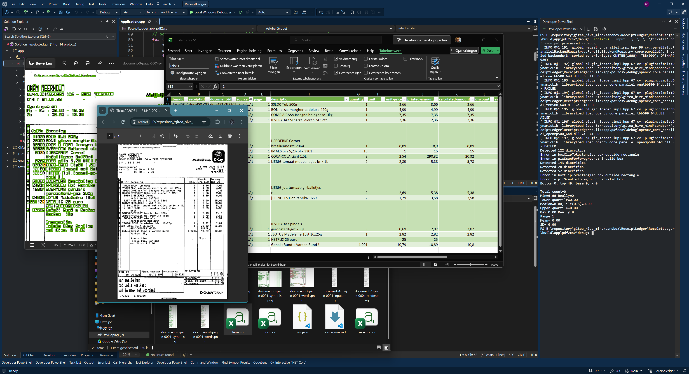

# ReceiptLedger

ReceiptLedger is an ongoing personal project that uses OCR to extract information from receipts, with the goal of storing that data in a database for bookkeeping.

## Workflow

1. Scan receipts with a document scanner, regardless of their original size or format.
2. Save each scanned receipt as a single PDF on a NAS.
3. Extract text using Tesseract OCR with Dutch language data.
4. Turn the extracted information into structured receipt data for database storage.

## Current Status

**Work in progress — the OCR foundation is working.**

- [x] Working Tesseract OCR setup with Dutch (`nld`) language data.
- [x] Required underlying dependencies installed and working.
- [x] A `pdf2cvs` tool to test the OCR workflow.
- [ ] Receipt classification by store or receipt type.
- [ ] Matching low-confidence OCR results against known articles in the database.
- A GUI may be considered only if the CLI no longer provides a workable way for the user to correct OCR errors.

## Background

My interest in OCR started about twenty years ago, when I encountered OCR engine code as part of a document management system (DMS). Later, I discovered OpenCV for image processing.

Projects such as [flomonster/ocr](https://github.com/flomonster/ocr), which explore image enhancement and neural network training, provide an interesting point of comparison.

For ReceiptLedger, I chose Tesseract as the OCR engine. For background on its architecture, see [An Overview of the Tesseract OCR Engine](https://static.googleusercontent.com/media/research.google.com/nl//pubs/archive/33418.pdf).

